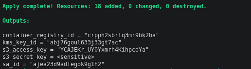
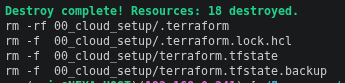
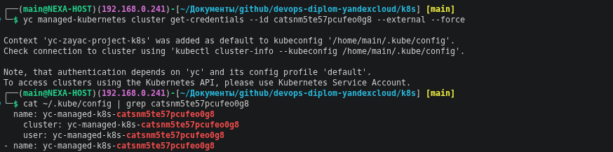
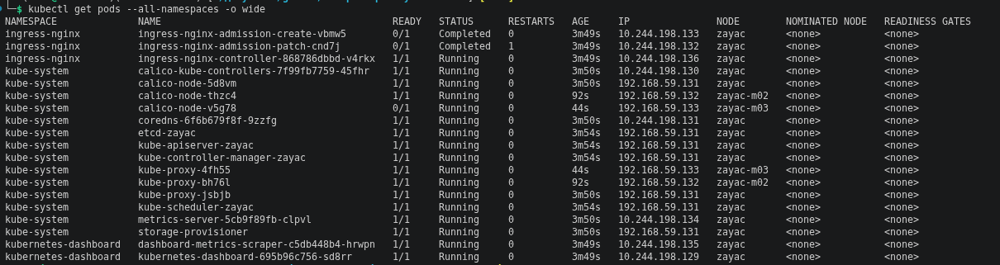
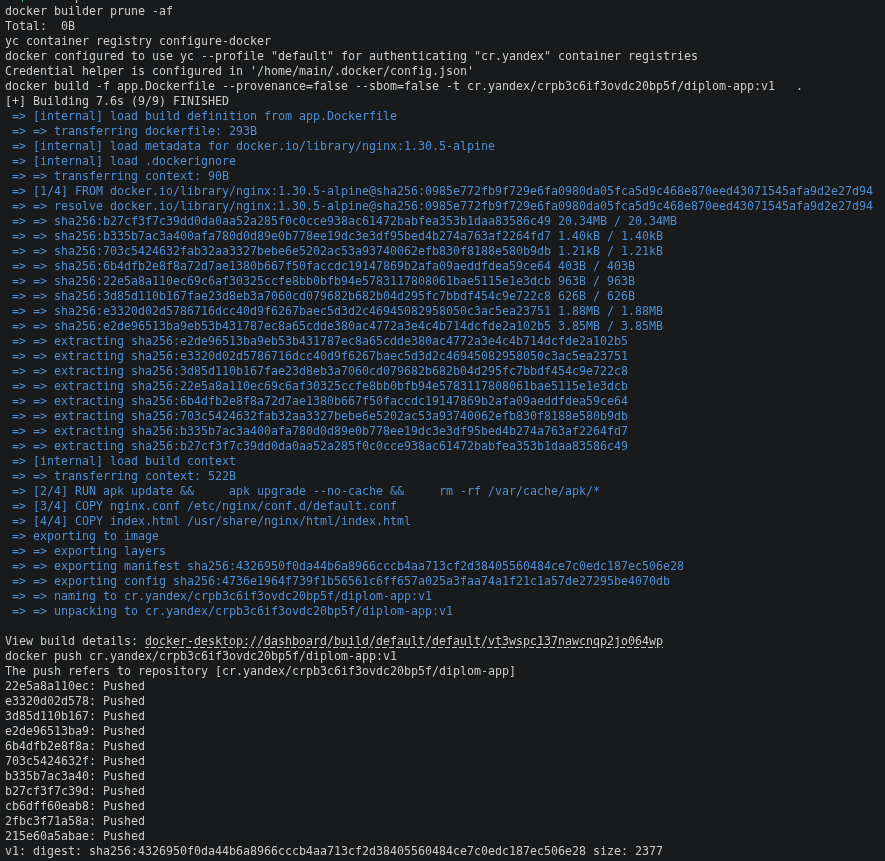
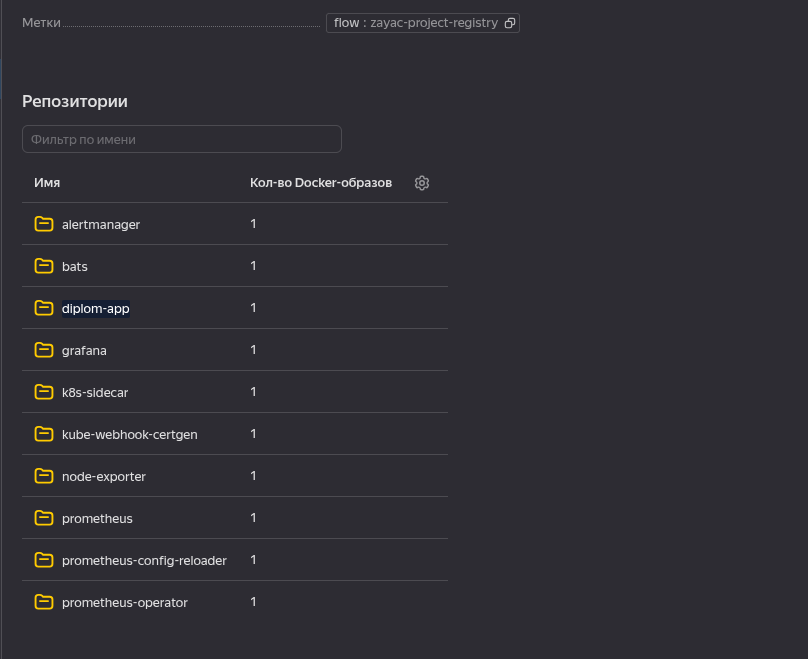
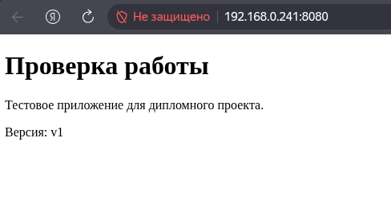
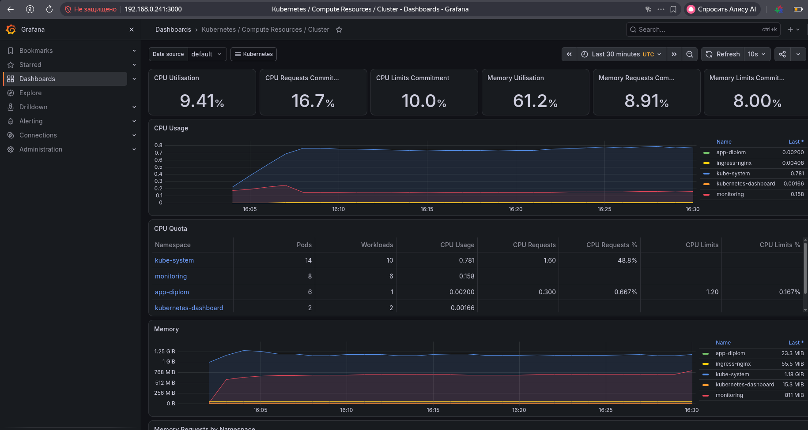
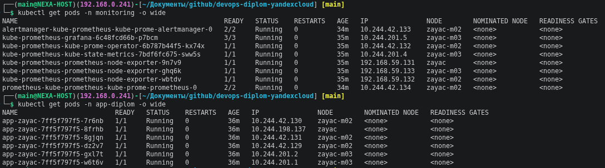
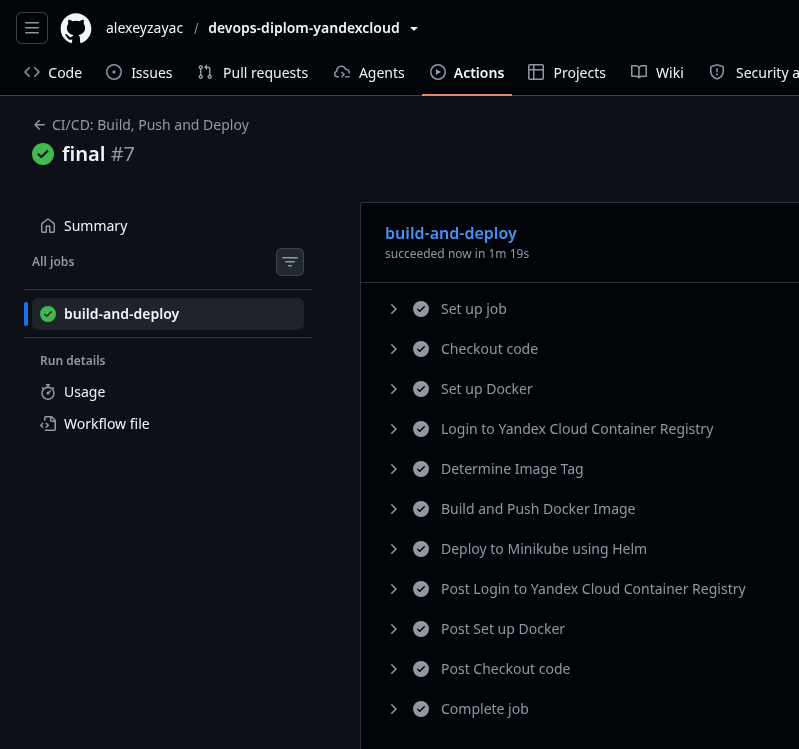

# Дипломная работа по профессии «DevOps-инженер»

> **Примечание:** Инфраструктура пересоздавалась несколько раз, поэтому в тексте могут отличаться ID ресурсов и другие детали. Актуальные значения смотрите в выводе `terraform output` соответствующих модулей.

## Этап 1. Создание облачной инфраструктуры

### Особенности выполнения

- **Мастер Kubernetes:** региональный, размещён в трёх зонах доступности.
- **Worker-ноды:** `preemptible = true`, `core_fraction = 20`, `cores = 2`, `memory = 4`.
- Конфигурация кластера: [`terraform/01_main/07_kubernetes.tf`](./terraform/01_main/07_kubernetes.tf).

### Предварительная подготовка

1. **Сервисный аккаунт для Terraform** с достаточными правами создаётся в [`terraform/00_cloud_setup/02_service_account.tf`](./terraform/00_cloud_setup/02_service_account.tf).
   - Имя: `terraform-sa`.
   - Роли: `editor`, `iam.admin`, `resource-manager.admin`, `kms.admin`, `container-registry.admin`.
   - Ключи хранятся в [`terraform/secret/`](./terraform/secret/).

2. **Backend S3 bucket** создаётся в [`terraform/00_cloud_setup/04_storage.tf`](./terraform/00_cloud_setup/04_storage.tf). Для шифрования используется KMS-ключ из [`terraform/00_cloud_setup/03_kms.tf`](./terraform/00_cloud_setup/03_kms.tf).
   - Файл `backend.hcl` с реквизитами доступа генерируется через [`terraform/00_cloud_setup/06_local_files.tf`](./terraform/00_cloud_setup/06_local_files.tf).
   - Хранится в [`terraform/secret/`](./terraform/secret/).

3. **Конфигурация Terraform с backend на S3** описана в [`terraform/01_main/00_providers.tf`](./terraform/01_main/00_providers.tf).
   - Конфигурации разделены по директориям:
     - [`terraform/00_cloud_setup/`](./terraform/00_cloud_setup/) — `service_account`, `storage_bucket`, `container_registry`.
     - [`terraform/01_main/`](./terraform/01_main/) — остальная инфраструктура (VPC, K8s, KMS, IAM).

4. **VPC с подсетями в разных зонах доступности** создаётся в [`terraform/01_main/02_network.tf`](./terraform/01_main/02_network.tf).
   - `ru-central1-a`: `192.168.10.0/24` *(в актуальной конфигурации закомментирована)*.
   - `ru-central1-d`: `192.168.20.0/24`.
   - `ru-central1-e`: `192.168.30.0/24`.

5. **`terraform apply` и `terraform destroy`** выполняются без ручных действий. Для упрощения работы с Terraform используется `make` и [`Makefile`](./terraform/Makefile).

**Отработка `terraform apply`:**



**Отработка `terraform destroy`:**



---

## Этап 2. Создание Kubernetes кластера

1. **Кластер развёрнут через Yandex Managed Service for Kubernetes** — [`terraform/01_main/07_kubernetes.tf`](./terraform/01_main/07_kubernetes.tf).
   - Региональный мастер размещён в трёх зонах доступности: `ru-central1-a`, `ru-central1-d`, `ru-central1-e`.

> **Примечание:** из-за нестабильности в зонах `ru-central1-a` и `ru-central1-b` конфигурация была пересмотрена и мастер перенесён в две зоны — `ru-central1-d` и `ru-central1-e`. В финальном варианте используется зональный мастер.

2. **Сервисный аккаунт для Kubernetes** создаётся в [`terraform/01_main/04_service_account_k8s.tf`](./terraform/01_main/04_service_account_k8s.tf).
   - Имя: `k8s_sa`.
   - Роли: `k8s.clusters.agent`, `vpc.publicAdmin`, `container-registry.images.puller`, `load-balancer.admin`, `compute.viewer`.

3. **Конфигурация kubeconfig** — вывод `cat ~/.kube/config`:



4. **Проверка работы кластера** — `kubectl get pods --all-namespaces`:

> **Примечание:** вывод получен на локальном Minikube, так как развернуть облачный кластер не удалось из-за квот. Для локального тестирования использовалась команда:

```bash
minikube start --kubernetes-version=v1.31.0 \
  --driver=virtualbox \
  --cpus=4 --memory=4gb --disk-size=20gb \
  --addons=dashboard,ingress,metrics-server \
  --cni=calico \
  --container-runtime=containerd \
  --nodes=3 \
  -p zayac
```



---

## Этап 3. Создание тестового приложения

1. **Dockerfile** написан самостоятельно: [`app/app.Dockerfile`](./app/app.Dockerfile). Остальные файлы приложения — в директории [`app/`](./app/).

2. **Сборка образа и пуш в Yandex Container Registry.** Для упрощения используется [`Makefile`](./app/Makefile):



3. **Реестр создан через Terraform:** [`terraform/00_cloud_setup/05_registry.tf`](./terraform/00_cloud_setup/05_registry.tf).

4. **Зеркалирование образов для системы мониторинга** выполнено скриптом [`k8s/monitoring/mirror-images.sh`](./k8s/monitoring/mirror-images.sh) — образы скопированы в Yandex Container Registry для последующего развёртывания через Helm по причине не доступности Docker Hub.



---

## Этап 4. Подготовка системы мониторинга и деплой приложения

> **Примечание:** ранее инфраструктура была поднята в Yandex Cloud, приложение и система мониторинга работали корректно. Предоставить скриншоты из облака не удалось из-за проблем с Yandex Cloud — ниже приведены локальные запуски на Minikube.

### Деплой тестового приложения

Helm-чарт приложения: [`k8s/app-diplom/chart/`](./k8s/app-diplom/chart/).
Файл `values-image.yaml` с актуальным тегом образа генерируется автоматически из [`terraform/00_cloud_setup/06_local_files.tf`](./terraform/00_cloud_setup/06_local_files.tf).

```bash
cd k8s/
kubectl create namespace app-diplom
helm upgrade --install app-diplom ./app-diplom/chart \
    -n app-diplom --create-namespace \
    -f ./app-diplom/values-image.yaml
```



### Развёртывание системы мониторинга

Система мониторинга развёрнута через Helm-чарт с использованием значений из [`k8s/monitoring/monitoring-values.yaml`](./k8s/monitoring/monitoring-values.yaml). Образы для Prometheus, Grafana, Alertmanager и node-exporter предварительно зеркалированы в Yandex Container Registry.

```bash
kubectl create namespace monitoring
helm upgrade --install kube-prometheus prometheus-community/kube-prometheus-stack \
    --namespace monitoring \
    --values monitoring/monitoring-values.yaml \
    --wait --timeout 15m
```





---

## Этап 5. Установка и настройка CI/CD

> **Примечание:** actions-runner установлен на локальной машине, где развёрнут Minikube.

**Триггеры:**
- `push` в ветку `main`;

**Описание jobs:** [`.github/workflows/deploy.yml`](./.github/workflows/deploy.yml).

**Что делает workflow:**
1. Собирает Docker-образ приложения.
2. Публикует образ в Yandex Container Registry или с тегом релиза.
3. Обновляет Helm-релиз `app-diplom` в Minikube на новый образ.
4. Подтверждает успешный деплой через `kubectl rollout status`.



---

## Итог

В рамках дипломной работы выполнены все пять этапов:

| Этап | Результат |
|------|-----------|
| 1. Облачная инфраструктура | Terraform-конфигурация с разделением на `00_cloud_setup` и `01_main`, S3-backend с шифрованием KMS, VPC в трёх зонах. `apply` и `destroy` отрабатывают без ручных действий. |
| 2. Kubernetes кластер | Развёрнут Yandex Managed Service for Kubernetes; сервисные аккаунты и роли настроены через Terraform. Из-за ограничений Yandex Cloud дальнейшая отладка велась на локальном Minikube. |
| 3. Тестовое приложение | Самостоятельно написан `Dockerfile` на базе `nginx:1.30.5-alpine`, образ собран и запушен в Yandex Container Registry. |
| 4. Мониторинг и деплой | Развёрнуты kube-prometheus-stack (Prometheus, Grafana, Alertmanager, node-exporter) и тестовое приложение через Helm-чарты. |
| 5. CI/CD | Настроен GitHub Actions с self-hosted runner: автоматическая сборка, публикация образа и деплой в Minikube по пушам в `main`. |

**Первые четыре этапа были полностью протестированы в Yandex Cloud** на региональном кластере Kubernetes с тремя зонами доступности. Скриншоты облачных запусков не сохранились, так как основное внимание уделялось отладке конфигураций, а не подготовке отчётности.

**Пятый этап (CI/CD) отлажен и работает локально** на Minikube с self-hosted runner, что полностью соответствует требованиям задания и позволяет продемонстрировать пайплайн в действии.