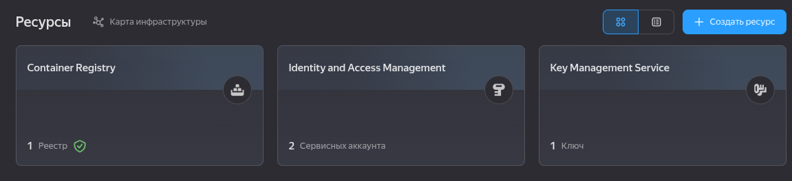

# Дипломная работа профессии "DevOps-инженер"

**PS: Инфраструкура пересоздавалась несколько раз в связи с чем могут отличаться id и прочее.**

## Этап 1. Создание облачной инфраструктуры

### Особенности выполнения 

Региональный мастер в 3 зонах; ноды `preemptible = true`, `core_fraction = 20`, `cores=4`, `memory=4`

Конфигурация предоставлена и находиться [`terraform/01_main/07_kubernetes.tf`](./terraform/01_main/07_kubernetes.tf)

### Предварительная подготовка к установке и запуску Kubernetes кластера.

1. Сервисный аккаунт для Terraform с достаточными правами создаётся в конигурации [`terraform/00_cloud_setup/02_service_account.tf`](./terraform/00_cloud_setup/02_service_account.tf). 
* SA название: `terraform-sa`, права: `editor`, `iam.admin`, `resource-manager.admin`, `kms.admin`, `container-registry.admin` и храняться в [`terraform/secret/`](./terraform/secret/).

2. Backend S3 bucket создаётся в конигурации [`terraform/00_cloud_setup/04_storage.tf`](./terraform/00_cloud_setup/04_storage.tf) + KMS ключ для шифрования [`terraform/00_cloud_setup/03_kms.tf`](./terraform/00_cloud_setup/03_kms.tf). 
* Переменные в виде файла для `backend` создаються в конигурации [`terraform/00_cloud_setup/06_local_files.tf`](./terraform/00_cloud_setup/06_local_files.tf) и храняться в [`terraform/secret/`](./terraform/secret/) 

3. Конфигурация с backend на S3 создаётся в конигурации [`terraform/01_main/00_providers.tf`](./terraform/01_main/00_providers.tf). 
* Конфигурации инфроструктуры предоставлены в разных дерикториях:
    * [`terraform/00_cloud_setup/`](./terraform/00_cloud_setup/) - Создаётся `service_account`, `storage_bucket`, `container_registry`
    * [`terraform/01_main/`](./terraform/01_main/) - Создаётся остальная инфраструктура. 

4. VPC с подсетями в разных зонах доступности создаётся в конигурации [`terraform/01_main/02_network.tf`](./terraform/01_main/02_network.tf)
* Подсеть в зоне `ru-central1-a`: `192.168.10.0/24`
* Подсеть в зоне `ru-central1-d`: `192.168.20.0/24`
* Подсеть в зоне `ru-central1-e`: `192.168.30.0/24`

5. `terraform apply` и `terraform destroy` выполняються без ручных действий. Для успрощения развёртывания была использована утилита make, дальше она активна используется для упрощеного выполнения команд.
* [`Makefile`](./terraform/Makefile) для работы с Terraform

Отработка `terraform apply`:


Отработка `terraform destroy`:


Итог поднятой инфраструктуры после отработки модуля конфигурации из директории [`terraform/00_cloud_setup/`](./terraform/00_cloud_setup/):



Итог поднятой инфраструктуры после отработки модуля конфигурации из директории [`terraform/01_main/`](./terraform/01_main/):

**PS: скриншот после пересоздания инфроструктуры с отключением сканера безопасности для Yandex Container Registry в связи с высокой платой.**

---

## Этап 2. Создание Kubernetes кластера

1. Инфра подниамалася через `Yandex Managed Service for Kubernetes` [`01_main/07_kubernetes.tf`](/terraform/01_main/07_kubernetes.tf)
* Региональный мастер в 3 зонах доступности: `ru-central1-a`, `ru-central1-d`, `ru-central1-e`

**PS: В связи с ситуацией в зоне доступности `ru-central1-a` и `ru-central1-b`, было принято переделать и провести работы в 2 зонах `ru-central1-d` и `ru-central1-e`.** 

2. Сервисный аккаунт для Terraform с достаточными правами создаётся в конигурации [`terraform/01_main/04_service_account_k8s.tf`](./terraform/01_main/04_service_account_k8s.tf)
SA название: `k8s_sa`, права: `k8s.clusters.agent`, `vpc.publicAdmin`, `container-registry.images.puller`, `load-balancer.admin`, `compute.viewer`

3. Вывод: `cat ~/.kube/config`


4. Вывод: `kubectl get pods --all-namespaces`

**PS: вывод через minikube по причине проблем при поднятие инфраструктуры в YC по известным причинам.**

**PS 2: как итог сейчас машины не поднимаються из-за квот и было придпринято испрользовать локальное решение minikube**

```bash
minikube start --kubernetes-version=v1.31.0 \
  --driver=virtualbox \
  --cpus=4 --memory=4gb --disk-size=20gb \
  --addons=dashboard,ingress,metrics-server \
  --cni=calico \
  --container-runtime=containerd \
  --nodes=3 \
  -p zayac
```


---

## Этап 3. Создание тестового приложения

1. Самостоятельно созданный [`Dockerfile`](./app/app.Dockerfile) остальные файлы предоставлены в директории [`app/`](./app/)

2. Сборка образа и пуш в Yandex Container Registry, для упрощения использовался [`Makefile`](/app/Makefile):


3. Реестр создан через Terraform [`terraform/00_cloud_setup/05_registry.tf`](/terraform/00_cloud_setup/05_registry.tf)

Также при помощи скрипта [`bash`](/k8s/monitoring/mirror-images.sh) были запушены образа контейнеров для развёртывания системы мониторинга через `helm`. 


---

## Этап 4. Подготовка cистемы мониторинга и деплой приложения

**PS: Ранее инфраструктура была поднята в облаке. Приложения и система мониторинга работала корректно. Предоставит скриншоты отсутсвует из-за проблем yandex**

`Chart` для приложения предоставлен по пути: [`k8s/app-diplom/chart/`](./k8s/app-diplom/chart/)
* values-image.yaml - для автоподставки image в `helm chart` генерируется через terraform [`terraform/00_cloud_setup/06_local_files.tf`](./terraform/00_cloud_setup/06_local_files.tf)

```bash
cd k8s/
kubectl create namespace app-diplom
helm upgrade --install app-diplom ./app-diplom/chart \
	-n app-diplom --create-namespace \
	-f ./app-diplom/values-image.yaml
```


Система мониторинга развёрнута через `helm chart` с испоьзованием переменных с Yandex Container Registry [`/k8s/monitoring/monitoring-values.yaml`](./k8s/monitoring/monitoring-values.yaml)

```bash
kubectl create namespace monitoring
helm upgrade --install kube-prometheus prometheus-community/kube-prometheus-stack \
    --namespace monitoring \
    --values monitoring/monitoring-values.yaml \
    --wait --timeout 15m
```


---

## Этап 5. Подготовка cистемы мониторинга и деплой приложения

